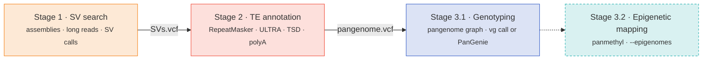

<p align="center"></p>

> [!IMPORTANT]
> **GraffiTE 1.1 is out, and it is now the default version.** Without `-r`,
> `nextflow run cgroza/GraffiTE` runs 1.1, but Nextflow reuses a copy it downloaded before: add
> `-latest`, or run `nextflow pull cgroza/GraffiTE` first. To keep running 1.0, pass
> `-r v1.0.0.0`. Flags, defaults and output files changed since 1.0; see
> [v1.0 vs v1.1](https://cgroza.github.io/GraffiTE/getting-started/v1.0-vs-v1.1/) and the
> [documentation](https://cgroza.github.io/GraffiTE/). We will post a preprint describing 1.1
> soon. We expect to release minor bug fixes; please report problems on the
> [issue tracker](https://github.com/cgroza/GraffiTE/issues).

[](https://github.com/cgroza/GraffiTE/issues) [![nextflow](https://img.shields.io/badge/powered_by:-Nextflow-9EE0CE?logo=)](https://www.nextflow.io/) [](LICENSE)

[](https://www.docker.com/) [![apptainer](https://img.shields.io/badge/use_with:-apptainer-blue?logo=)](https://apptainer.org/docs/admin/main/installation.html)

**GraffiTE finds transposable element insertion polymorphisms, annotates them, and genotypes them across read sets with a pangenome graph.**

Give it genome assemblies or long reads and a reference genome. It calls the structural variants,
keeps the ones that are mostly transposable element (TE) sequence, describes each element, and
builds a graph in which every polymorphism is a bubble so that short or long reads from any number
of samples can be genotyped at each one.

- Stage 1, SV search: insertions and deletions relative to the reference, from assemblies (`svim-asm`,
  PAV), long reads (`Sniffles2`), or variant calls you already have, merged into one set.
- Stage 2, TE annotation: RepeatMasker with your TE library, ULTRA for tandem repeats, target site
  duplications, polyA tails, and a `total_repeat_span` filter. A conservative "trusted" subset,
  or with `--human` a subset of recent human mobile elements with an HERV-K (HML-2) classifier.
- Stage 3.1, genotyping: PanGenie, Giraffe, or GraphAligner and `vg call`, one merged VCF plus
  presence/absence tables per sample.
- Stage 3.2, epigenetic mapping: with `--epigenomes`, GraffiTE lifts the methylation tags of the read BAMs onto
  the graph and adds them to the genotyped calls (panmethyl submodule; every graph method except PanGenie).



Each stage can be skipped by handing GraffiTE the output of the previous one, and the pipeline can
be used as a plain SV annotator (`--vcf`).

## What's new in 1.1

GraffiTE 1.1 maps methylation onto TE polymorphisms. With `--epigenomes`, the panmethyl submodule
reads the base-modification tags (`MM`/`ML`, 5mC at CpG by default) of the long-read BAMs you
genotype and lifts each modified base onto the pangenome graph, including TE sequence that the
reference lacks. The genotyped VCF then carries the methylation level, modified sites and depth of
each allele (`PML`, `PMN`, `PMD`), so you can compare the methylation of a TE insertion with that
of the empty site, or one haplotype's copy with the other's. Epigenetic mapping runs with the
giraffe, graphaligner and precomputed graph methods, not with PanGenie; see
[Stage 3.2: epigenetic mapping](https://cgroza.github.io/GraffiTE/guides/methylation/).

Also new:

- Discovery from PAV (`--pav`) or from your own per-sample SV calls (`--svs`).
- Annotation: ULTRA tandem repeats and the `total_repeat_span` filter, polyA tails, an exact-match
  TSD search on every record the repeat filter keeps, and the L1 5′ inversion and SVA VNTR checks
  on every data set (`--mammal` is no longer needed).
- A conservative `pangenome.trusted.vcf` subset, or with `--human` a subset of recent human mobile
  elements and an HERV-K (HML-2) classifier, with each locus consolidated into one record.
- Genotyping: an audit table recording what became of every allele, a trusted subset of the
  genotyped calls, and fixes to the PanGenie path.

The command line changed in a few places (`--reads` is now `--genotype_with`). The full list is in
[v1.0 vs v1.1](https://cgroza.github.io/GraffiTE/getting-started/v1.0-vs-v1.1/) and the
[changelog](https://cgroza.github.io/GraffiTE/changelog/).

## Requirements

- Linux on x86-64. The container image is built for `linux/amd64`; on arm64 it runs under emulation.
- Java 17 or newer and [Nextflow](https://www.nextflow.io/docs/latest/install.html). The test suite
  runs on Nextflow 24.10.5, and `main.nf` also compiles under the strict syntax of Nextflow 26.04.
- [Apptainer](https://apptainer.org/docs/admin/main/installation.html) or Singularity, the default,
  or Docker with a config change.
- The first run downloads the container image, about 2.8 GB compressed. Some steps of a genome-scale
  run ask for 40 GB of memory or more by default; see
  [Resources](https://cgroza.github.io/GraffiTE/guides/resources/).

## Check your installation

```bash
nextflow pull cgroza/GraffiTE -r v1.1.0.0
tar xzf ~/.nextflow/assets/cgroza/GraffiTE/test/quick_test.tar.gz && cd graffite_quick_test
nextflow run cgroza/GraffiTE -r v1.1.0.0 -params-file quick_test.yaml
bash check.sh
```

The test runs discovery, annotation and genotyping on a 195 kb synthetic genome with four
assemblies and two short-read samples, and ends with `GraffiTE quick test: PASS`. On a machine
where Nextflow could use 4 CPUs and 12 GB of memory, the run took about 70 seconds once the image was
downloaded. The test genotypes with giraffe, because GraffiTE requests 32 GB for each task of
PanGenie, the default back end.

## A real-data example

The repository also ships the maternal assembly of HG002 chromosome 22, with a reference, a Dfam
library and a short-read set:

```bash
git clone --branch v1.1.0.0 --recurse-submodules https://github.com/cgroza/GraffiTE.git
tar xzf GraffiTE/test/human_test_set.tar.gz && cd GraffiTE_testset
nextflow run ../GraffiTE/main.nf \
  --assemblies assemblies.csv --reference hs37d5.chr22.fa \
  --TE_library human_DFAM3.6.fasta --genotype_with reads.csv
```

Nextflow pulls the container image `docker://cgroza/graffite:1.1.0.0` on first use. Installation,
execution profiles and a walk-through of this example are in the documentation.

## Documentation

The documentation is at **[https://cgroza.github.io/GraffiTE](https://cgroza.github.io/GraffiTE/)**. The v1.0 README,
for the version described in the paper, is at the
[`publication`](https://github.com/cgroza/GraffiTE/tree/publication) tag.

| I want to… | Read |
|---|---|
| Install GraffiTE and the container | [Installation](https://cgroza.github.io/GraffiTE/getting-started/installation/) |
| Run the test dataset end to end | [Quickstart](https://cgroza.github.io/GraffiTE/getting-started/quickstart/) |
| Know which flags fit my data | [Choosing your inputs](https://cgroza.github.io/GraffiTE/getting-started/choosing-your-inputs/) |
| Come from the paper (v1.0) | [v1.0 vs v1.1](https://cgroza.github.io/GraffiTE/getting-started/v1.0-vs-v1.1/) |
| Understand a stage | [Stage 1: SV search](https://cgroza.github.io/GraffiTE/guides/discovery/) · [Stage 2: TE annotation](https://cgroza.github.io/GraffiTE/guides/annotation/) · [Stage 3.1: genotyping](https://cgroza.github.io/GraffiTE/guides/genotyping/) · [Stage 3.2: epigenetic mapping](https://cgroza.github.io/GraffiTE/guides/methylation/) |
| Use the human mobile-element filter | [Human MEIs and HERV-K](https://cgroza.github.io/GraffiTE/guides/human-mei/) |
| Reuse work from an earlier run | [Resuming and skipping work](https://cgroza.github.io/GraffiTE/guides/skipping-work/) |
| Look up a parameter, file or VCF field | [Parameters](https://cgroza.github.io/GraffiTE/reference/parameters/) · [Outputs](https://cgroza.github.io/GraffiTE/reference/outputs/) · [VCF fields](https://cgroza.github.io/GraffiTE/reference/vcf-fields/) · [Samplesheets](https://cgroza.github.io/GraffiTE/reference/samplesheets/) |
| Size a run for my cluster | [Resources](https://cgroza.github.io/GraffiTE/guides/resources/) |
| Fix a failing run | [Troubleshooting](https://cgroza.github.io/GraffiTE/troubleshooting/) |
| See what changed | [Changelog](https://cgroza.github.io/GraffiTE/changelog/) |

For language models: [llms.txt](https://cgroza.github.io/GraffiTE/llms.txt) and the concatenated [llms-full.txt](https://cgroza.github.io/GraffiTE/llms-full.txt).

## Citation

The 2024 paper describes GraffiTE 1.0:

[](https://www.nature.com/articles/s41467-024-53294-2)

> Groza, C., Chen, X., Wheeler, T.J. et al. A unified framework to analyze transposable element
> insertion polymorphisms using graph genomes. *Nature Communications* **15**, 8915 (2024).
> [doi:10.1038/s41467-024-53294-2](https://doi.org/10.1038/s41467-024-53294-2)

GraffiTE was developed by Cristian Groza and Clément Goubert in
[Guillaume Bourque's group](https://computationalgenomics.ca/BourqueLab/) at the
[McGill Genome Centre](https://www.mcgillgenomecentre.ca/), Montréal. It builds on the graph
genotyping protocol of [Groza et al. 2022](https://link.springer.com/protocol/10.1007/978-1-0716-2883-6_5).

## Licence and support

GraffiTE is released under the [MIT licence](LICENSE). Bugs, questions and suggestions go to the
[issue tracker](https://github.com/cgroza/GraffiTE/issues).

## Star History

[](https://www.star-history.com/#cgroza/GraffiTE&type=date&legend=top-left)
