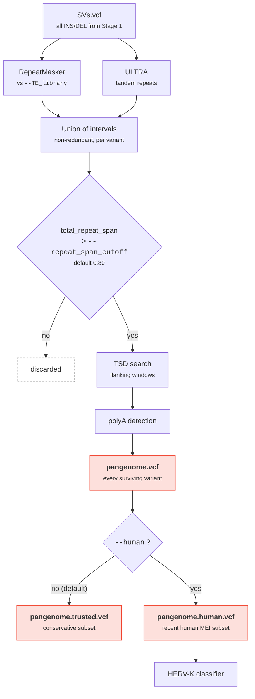

# Stage 2: TE annotation

!!! info "Applies to GraffiTE v1.1"
    Verified against `v1.1.0.0` at commit `bf51777`. The
    [2024 paper](https://www.nature.com/articles/s41467-024-53294-2) describes v1.0, which
    differs in places; see [v1.0 vs v1.1](../getting-started/v1.0-vs-v1.1.md).

Stage 2 takes the merged SV set from [Stage 1](discovery.md) (or the VCF you gave it), measures how
much of each variant's sequence is repeat, and names the repeat. Variants that are not mostly
repeat are discarded. The rest come out as `pangenome.vcf` with the annotation fields described in
[VCF fields](../reference/vcf-fields.md), plus a filtered subset.

## What Stage 2 does



!!! important "`--human` replaces the trusted subset"
    With `--human`, `pangenome.trusted.vcf` and `pangenome.presence-absence_trusted.tsv` are not
    written at all. The human filter is applied to `pangenome.vcf` directly, not on top of the
    trusted subset. This changed in v1.1; earlier versions produced
    `pangenome.trusted.human.vcf` as a subset of the trusted set.
    <span class="src">`module/main.nf:597-608`</span>

## TE library

`--TE_library` is a FASTA of repeat consensus sequences passed to RepeatMasker as `-lib`. It alone
determines what a variant is called, so the names and classes in it are the names and classes
you get back in `repeat_ids` and `matching_classes`. Two things in it matter
to the annotation:

- **The class in the header.** RepeatMasker reads `#class/family` after the name
  (`AluYa5#SINE/Alu`, `L1HS#LINE/L1`, `LTR5_Hs#LTR/ERVK`). That string is `matching_classes`. The
  filters test it literally, so a library that says `SINE/Alu` works with `--human` and one that
  says `Alu` does not. Sequences whose class is `Simple_repeat` or `Low_complexity` are ignored
  by the annotation, and do not count toward the TE span.
  <span class="src">`bin/annotate_vcf.R:98`, `bin/repmask_vcf.sh:114`</span>
- **The names.** `--human` matches its whitelists against `repeat_ids` with anchored prefixes
  (`^AluY`, `^L1HS`, `^SVA_[DEF]`, `^HERVK-int`), and the L1 and SVA rules key on the classes
  `LINE/L1` and `Retroposon/SVA` and on the subfamily names `SVA_A` to `SVA_F`. A library with
  other conventions still works for annotation, but those rules will not fire.
  <span class="src">`nextflow.config:70-81`, `bin/annotate_vcf.R:119,132-140`</span>

The Dfam human library the test set ships (`human_DFAM3.6.fasta`) follows these conventions. For
another species, use a RepeatModeler or Dfam library in RepeatMasker format; see
[Choosing your inputs](../getting-started/choosing-your-inputs.md).

## RepeatMasker and ULTRA

`repeatmask_VCF` runs once per contig of the merged VCF. It writes each indel's sequence
(the ALT of an insertion, the REF of a deletion) to `indels.fa`, named by variant ID, and
runs two tools on that file.
<span class="src">`bin/repmask_vcf.sh:38-39`</span>

**RepeatMasker**, in sensitive mode against your library, with a quarter of the task's cores as
parallel jobs (RepeatMasker uses four threads per job):
<span class="src">`bin/repmask_vcf.sh:67-75`</span>

```bash
RepeatMasker -lib ${TE_library} -s -dir repeatmasker_dir -pa $(( $(nproc) / 4 )) indels.fa
```

The paper version passed `-nolow` here. v1.0 dropped it on 2025-10-01 (`1cbebbf`) because it
could produce spurious TE hits on tandem repeats; simple repeats are still masked, then set aside
by the annotation.

**ULTRA**, on every core, to find tandem repeats whether or not RepeatMasker called them
something:
<span class="src">`bin/repmask_vcf.sh:92`</span>

```bash
ultra --bed -t $(nproc) -o ultra_temp/ultra_out indels.fa
```

`annotate_vcf.R` then parses RepeatMasker's `.out` table. It groups fragments that share a
RepeatMasker link ID into one **hit**, named after the highest-scoring fragment;
that is where `n_hits`, `fragmts`, `repeat_ids`, `matching_classes`, `RM_hit_strands` and
`RM_hit_IDs` come from. v1.0 used OneCodeToFindThemAll for this grouping; v1.1 reads the `.out`
file directly.
<span class="src">`bin/repmask_vcf.sh:108`, `bin/annotate_vcf.R:97-114`</span>

Two rules run on the grouped hits before they are written out: the L1 twin-priming rule that
sets `L1_5PINV`, and the SVA VNTR rule that renames a hit lying inside the VNTR and moves it to
`Simple_repeat`. Both are described on their own pages,
[L1 5' inversions](../background/l1-5prime-inversion.md) and
[SVA VNTR polymorphisms](../background/sva-vntr.md).

## Repeat-span filter

Each variant gets one number, `total_repeat_span`: the fraction of its sequence covered by the
union of RepeatMasker TE intervals (simple repeats and low complexity excluded) and ULTRA
tandem-repeat intervals, overlaps counted once, capped at 1.
<span class="src">`bin/repmask_vcf.sh:139-147`</span>

A variant is kept when `total_repeat_span` is strictly greater than `--repeat_span_cutoff`
(default `0.80`, a fraction of the variant length). The test is applied twice with the same
cutoff: once per contig, which produces `genotypes_repmasked_filtered.vcf`, and once more when
the contigs are concatenated.
<span class="src">`module/main.nf:661`, `module/main.nf:579`, `nextflow.config:61`</span>

Because the filter uses the union rather than the TE span alone, a polyA-rich Alu with a long
tandem stretch passes: ULTRA covers what RepeatMasker did not. A variant that is nothing but a
tandem repeat also passes the span filter, with `n_hits=0`; it is the trusted and human subsets,
downstream, that require a TE hit.

`total_match_span`, the v1.0 metric (TE intervals only, no ULTRA), is still written but no longer
tested.

## Target site duplications

For every variant that passed the filter, GraffiTE takes `--tsd_win` bp (default 30) of reference
on each side of the breakpoint and the same width from each end of the variant sequence, and
looks for an exact duplication of 4 to 20 bp that sits close to the junctions. A duplication that
passes is written as `INFO/TSD`, as its two copies. The search runs on every variant, whatever
its `n_hits`. The procedure, the scoring and the log format are in
[Target site duplications](../background/tsd.md).
<span class="src">`module/main.nf:665-709`, `nextflow.config:54`</span>

## polyA annotation

`add_polyA.py` runs on the concatenated VCF after `fix_vcf.py` has re-read the reference alleles. For a
variant with exactly one hit it scans the 3' end of the variant sequence for an A-rich tail when
the hit is on the `+` strand, or the 5' end for a T-rich tail when it is on `C`. It scans that
end twice, with the matching copy of `TSD` trimmed off and with it left on, and calls a tail if
either scan finds a window of at least 8 bp with at least 80% A (or T) ending within 5 bp of the
terminus. The trim exposes a tail that sits behind the copy; the untrimmed scan keeps a tail that
the TSD search reported as part of the duplication. The result is `polyA=TRUE` or `FALSE`; a
variant with more than one hit gets `NA` and is not scanned. The three constants are fixed in the
script.
<span class="src">`bin/add_polyA.py:24-26,71-95,109-158`, `module/main.nf:589`</span>

## Trusted subset

Without `--human`, `concat_repeatmask` also writes `pangenome.trusted.vcf`, the records that pass
this `bcftools view -i` expression, with the defaults filled in:
<span class="src">`module/main.nf:16-18,23-26,600`</span>

```text
n_hits==1
& abs(SVLEN)>=250
& (ULTRA_TR_span<0.6 | matching_classes="Simple_repeat")
& FILTER="PASS"
```

Read as three criteria:

| Criterion | Parameter | Default |
|---|---|---|
| One RepeatMasker hit, so the variant is one element and not a nested or composite one. | none | |
| Long enough to be a full-length element rather than a fragment. | `--trusted_min_svlen` | `250` bp |
| Not dominated by tandem repeat, unless the SVA VNTR rule moved its hit to `Simple_repeat`. | `--trusted_max_ultra_span` | `0.6` (fraction of variant length) |

The `FILTER="PASS"` clause is dropped with `--trusted_ignore_filter`, for callers that leave
`FILTER` empty.
<span class="src">`nextflow.config:62-64`</span>

!!! note "No polyA requirement"
    The trusted subset has no polyA requirement: with an uncurated library, an element filed
    under the wrong class would lose its record. The `--human` filter requires a polyA tail of
    Alu, L1 and SVA records, and is written with positive matches because bcftools `!~` does not
    negate reliably on these fields; see [VCF fields](../reference/vcf-fields.md).
    <span class="src">`module/main.nf:10-18,546-550`</span>

For human data, `--human` replaces this subset with a filter on recent subfamilies; see
[Human MEIs](human-mei.md).

## Parallelism and batching

Stage 2 parallelizes twice.

- **By contig.** `split_repeatmask` writes one VCF per contig of the merged set and
  `repeatmask_VCF` runs on each, with the `repeatmasker_*` resource parameters. With variants on
  thousands of small scaffolds, that is thousands of tasks; `--cores` and
  `--repeatmasker_threads` set what each gets. RepeatMasker's own `-pa` is a quarter of that.
  <span class="src">`module/main.nf:495-508`, `nextflow.config:228-232`</span>
- **By batch of variants for the TSD search.** Each contig's variant list is split into batches
  of `--tsd_batch_size` (default 100 variants) and `tsd_search` runs on each batch with the
  `tsd_*` parameters, so a contig with 5,000 variants is 50 tasks. `tsd_report` gathers the
  batches back per contig.
  <span class="src">`main.nf:157-162`, `nextflow.config:60`</span>

`concat_repeatmask` then joins every contig into `pangenome.vcf`. Everything in this stage is
recoverable with `-resume`, and a finished Stage 2 can be re-entered with `--RM_dir` or
`--graffite_vcf`; see [Resuming and skipping work](skipping-work.md).
