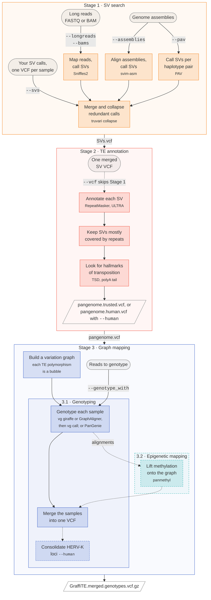

<h1 class="gt-masthead"></h1>

Pangenomic toolbox for the analysis of transposable element insertion polymorphisms.

!!! info "Applies to GraffiTE v1.1"
    Verified against `v1.1dev` at commit `e687712`. The
    [2024 paper](https://www.nature.com/articles/s41467-024-53294-2) describes v1.0, which
    differs in places; see [v1.0 vs v1.1](getting-started/v1.0-vs-v1.1.md).

GraffiTE takes genome assemblies or long-read datasets, finds the structural variants that are
transposable element (TE) insertions or deletions relative to a reference genome, annotates what
those elements are, and then genotypes the polymorphisms in as many read sets as you like by
building a pangenome graph with the TEs as bubbles.

It handles both **non-reference** insertions (a TE present in your sample, absent from the
reference) and **reference** insertions (a TE present in the reference, absent from your sample).
You can also use it only as an annotator: hand it a VCF of structural variants and it reports
which of them are TEs.

---

## GraffiTE workflow

A GraffiTE run covers some or all of three stages in series. The third has two parts: genotyping,
and an optional epigenetic mapping. Which stages run depends on the inputs you supply.

Rounded: your input. Slanted: a file GraffiTE writes. Dashed: optional, or a shortcut.
Every stage also reads the reference genome (<code>--reference</code>), and Stage 2 reads a TE
library in RepeatMasker format (<code>--TE_library</code>).

**Stage 1, SV search.** GraffiTE aligns each assembly or read set to the reference, calls
structural variants, and keeps only insertions and deletions. You can mix callers and input types
in one run; GraffiTE merges everything into a single non-redundant SV set.

**Stage 2, TE annotation.** RepeatMasker scans every candidate SV allele against your TE library,
and ULTRA scans it for tandem repeats. GraffiTE discards variants that are not mostly repeat and
annotates the rest with their repeat identity, target site duplications and polyA tails.

**Stage 3.1, genotyping.** GraffiTE builds a pangenome graph with the annotated polymorphisms as
bubbles and genotypes each sample at those in the graph. The default back end,
`--graph_method pangenie`, counts k-mers against a PanGenie index and never aligns; `giraffe`
and `graphaligner` map the reads onto the graph and call genotypes with `vg call`.

**Stage 3.2, epigenetic mapping, optional.** With `--epigenomes`, on the `giraffe`,
`graphaligner` and `precomputed` graph methods (every method but `pangenie`), the `panmethyl`
submodule lifts the base modifications carried by the genotyping BAMs onto the graph and
summarizes them per polymorphism. See [Epigenetic mapping](guides/methylation.md).

Stage 3 is optional (`--genotype false`). Stages 1 and 2 can each be skipped by supplying their
outputs directly; see [Resuming and skipping work](guides/skipping-work.md).

---

## Reference and non-reference insertions

GraffiTE reports variants **relative to the reference genome**. Read the direction off the
allele lengths: ALT longer than REF is a
non-reference insertion, REF longer than ALT is a reference insertion. `SVLEN` is positive for the
first and negative for the second. Do not use `SVTYPE` for this. On any run with two or more
caller VCFs, `truvari_merge` strips every upstream INFO field before the collapse and adds back
only `SVLEN`, so `pangenome.vcf` has no `SVTYPE`. It survives only on the single-input paths,
`--vcf` and a single caller VCF.

<figure>
--8<-- "assets/ref-vs-nonref-insertion.svg"
<figcaption>
ALT longer than REF means the element is <em>absent</em> from the reference and
<em>present</em> in the sample. REF longer than ALT means the element is <em>present</em> in
the reference and <em>absent</em> from the sample. The <code>SVTYPE</code> values shown appear
only on the single-input paths. In both cases GraffiTE annotates the element itself.
</figcaption>
</figure>

**An ALT allele does not mean "TE present"**. For a reference insertion the relationship is
inverted. `vcf_to_pa_tsv.py` writes the presence-absence TSVs and does that conversion for you:
a `1` always means the TE is in that sample, whichever way the record points. It reads the
direction from `INFO/SVTYPE` where there is one and from the allele lengths where there is not,
which is what a run with two or more caller VCFs produces. It writes `NA` where neither gives a
direction: on a symbolic or multi-allelic ALT, or when REF and ALT are the same length. See
[Output files](reference/outputs.md).

---

## Glossary

Where the codebase uses a term loosely, this table states the meaning that applies here.

| Term | Meaning |
|---|---|
| **MEI** | Mobile element insertion; on these pages, one that is present in some haplotypes and absent from others. The v1.0 README calls them pMEs, polymorphic mobile elements. We use MEI, the more common term. |
| **Non-reference insertion** | TE present in the sample, absent from the reference. ALT longer than REF, `SVLEN` positive. |
| **Reference insertion** | TE present in the reference, absent from the sample. REF longer than ALT, `SVLEN` negative. |
| **Hit** | One RepeatMasker match after fragment grouping, a single element. Counted by the `n_hits` INFO field. |
| **Fragment** | One raw line of RepeatMasker output. Several fragments may be grouped into one hit. Counted by `fragmts`. |
| **Repeat span** | The fraction of a variant's sequence covered by the non-redundant union of RepeatMasker TE hits and ULTRA tandem repeats. The `total_repeat_span` INFO field; the main quality filter. |
| **Trusted subset** | A conservative subset of `pangenome.vcf`: single-hit, at least 250 bp, not dominated by tandem repeat, and polyA-supported if it is a non-LTR retrotransposon. Written to `pangenome.trusted.vcf`. |
| **Human MEI subset** | With `--human`, a subset filtered to recent human mobile element subfamilies (AluY, L1HS, SVA_D/E/F, HML-2). Written to `pangenome.human.vcf`, **instead of** the trusted subset. |
| **TSD** | Target site duplication. A short direct repeat flanking a genuine mobile element insertion, created by the integration mechanism. |
| **Locus** (HERV-K) | With `--human`, the set of records that describe the same HML-2 element. Two records share a locus when they touch the same reference HML-2 element, or when their footprints lie within `--hervk_locus_window` (`1200` bp) of each other. Named by the `HERVK_LOCUS` INFO field. |
| **Consolidated VCF** | With `--human`, a VCF in which each HERV-K locus is one record with per-allele states (`pangenome.human.consolidated.vcf`, and `GraffiTE.merged.genotypes.human.vcf.gz` after genotyping). |
| **Precomputed** | The `--graph_method precomputed` mode: no graph is built and no reads are mapped; the run reuses a `--graph` directory with `--vcfs` or `--graph_alignments` from an earlier run. |
| **Stage 1 / 2 / 3** | SV search / TE annotation / graph mapping (3.1 genotyping, 3.2 epigenetic mapping), as above. |

---

## Where to go next

- :material-download: **[Installation](getting-started/installation.md)**

    Prerequisites, cloning with submodules, and the container image.

- :material-rocket-launch: **[Quickstart](getting-started/quickstart.md)**

    Run the bundled human chromosome-22 test dataset end to end.

- :material-sign-direction: **[Choosing your inputs](getting-started/choosing-your-inputs.md)**

    A decision tree from "what data do I have" to "which flags do I pass".

- :material-tune: **[Parameters](reference/parameters.md)**

    Every parameter, its default, and what it controls.

- :material-file-tree: **[Output files](reference/outputs.md)**

    What GraffiTE writes and where.

- :material-dna: **[Human MEIs](guides/human-mei.md)**

    The `--human` filter and the HERV-K classifier.

- :material-flask-outline: **[Epigenetic mapping](guides/methylation.md)**

    Lift base modifications from the genotyping BAMs onto the graph with `--epigenomes`.

- :material-compare: **[v1.0 vs v1.1](getting-started/v1.0-vs-v1.1.md)**

    What changed since the paper, flag by flag and field by field.

---

## Citing GraffiTE

> Groza, C., Chen, X., Wheeler, T.J. et al. A unified framework to analyze transposable element
> insertion polymorphisms using graph genomes. *Nature Communications* **15**, 8915 (2024).
> [doi:10.1038/s41467-024-53294-2](https://doi.org/10.1038/s41467-024-53294-2)

GraffiTE was developed by **Cristian Groza** and **Clément Goubert** in
[Guillaume Bourque's group](https://computationalgenomics.ca/BourqueLab/) at the
[McGill Genome Centre](https://www.mcgillgenomecentre.ca/), Montréal, Canada. It builds on the
concept described in [Groza et al., 2022](https://link.springer.com/protocol/10.1007/978-1-0716-2883-6_5).

Bugs, comments and suggestions are welcome in the
[issue tracker](https://github.com/cgroza/GraffiTE/issues).
