# Pipeline processes

!!! info "Applies to GraffiTE v1.1"
    Verified against `v1.1dev` at commit `e687712`. The
    [2024 paper](https://www.nature.com/articles/s41467-024-53294-2) describes v1.0, which
    differs in places; see [v1.0 vs v1.1](../getting-started/v1.0-vs-v1.1.md).

`module/main.nf` defines 25 processes. The methylation branch imports eight more from the
`panmethyl` submodule. The inputs you pass determine which ones run; Nextflow never schedules a
process with nothing on its input channel. `main.nf:12-18`

Every process runs in the GraffiTE container except `pav_asm`, which has its own. Nextflow puts the
repository's `bin/` on `PATH` inside every task. `nextflow.config:345`

---

## Process graph

```mermaid
%%{init: {"flowchart": {"nodeSpacing": 20, "rankSpacing": 26, "padding": 8}}}%%
flowchart TB
    subgraph SA["Stage 1 · SV search"]
        direction TB
        asmIn(["<code>--assemblies</code>"])
        lrIn(["<code>--longreads</code>"])
        bamIn(["<code>--bams</code>"])
        pavIn(["<code>--pav</code>"])
        svsIn(["<code>--svs</code>"])
        vcfIn(["<code>--vcf</code>"])
        bs["break_scaffold"]
        ma["map_asm"]
        sv["svim_asm"]
        ml["map_longreads"]
        ssc["sniffles_sample_call"]
        spc["sniffles_population_call"]
        pav["pav_asm"]
        tm["truvari_merge"]
        asmIn -.->|"<code>--break_scaffolds</code>"| bs --> ma
        asmIn --> ma --> sv --> tm
        lrIn --> ml --> ssc --> spc --> tm
        bamIn --> ssc
        pavIn --> pav --> tm
        svsIn --> tm
        vcfIn --> tm
    end

    subgraph SB["Stage 2 · TE annotation"]
        direction TB
        rmdIn(["<code>--RM_dir</code>"])
        spl["split_repeatmask"] --> rm["repeatmask_VCF"] --> tp["tsd_prep"] --> ts["tsd_search"] --> tr["tsd_report"] --> cr["concat_repeatmask"]
        rmdIn --> tp
        cr -.->|"<code>--human</code>"| ha["hervk_annotate"]
    end

    subgraph SC["Stage 3.1 · Genotyping"]
        direction TB
        pvIn[/"pangenome.vcf,<br/>or <code>--graffite_vcf</code>"/]
        readsIn(["<code>--genotype_with</code>"])
        graphIn(["<code>--graph</code>"])
        galnIn(["<code>--graph_alignments</code>"])
        vcfsIn(["<code>--vcfs</code>"])
        hkIn[/"hervk_annotate<br/>tables"/]
        epiIn[/"VCFs with methylation<br/>from Stage 3.2"/]
        b2f["bam_to_fastq"]
        pi["pangenie_index"] --> pg["pangenie"]
        mg["make_graph"] --> gar["graph_align_reads"] --> vc["vg_call"]
        pg --> mv["merge_VCFs"]
        vc --> mv
        mv --> ga["genotyping_audit"]
        mv -.->|"default"| tg["trusted_genotypes"]
        mv -.->|"<code>--human</code>"| hr["hervk_reconcile"]
        pvIn --> pi
        pvIn --> mg
        readsIn --> b2f
        readsIn --> pg
        readsIn --> gar
        b2f --> gar
        b2f --> pg
        graphIn -.->|"replaces"| mg
        galnIn -.->|"replaces"| gar
        vcfsIn -.->|"replaces"| vc
        hkIn -.-> hr
        epiIn -.-> mv
    end

    subgraph SM["Stage 3.2 · Epigenetic mapping · <code>--epigenomes</code>"]
        direction TB
        gIn[/"graph from make_graph"/]
        aIn[/"GAFs from graph_align_reads"/]
        bIn(["BAM rows of<br/><code>--genotype_with</code>"])
        vIn[/"VCFs from vg_call"/]
        liftIn(["<code>--lifted</code>"])
        bedIn(["<code>--bed</code>"])
        ig["index_graph"]
        b2b["bamtags_to_BED"] --> le["lift_epigenome"] --> mc["merge_CSV"] --> av["annotate_VCF"]
        b2g["BED_to_graph"] --> ab["annotate_BED"] --> mb["merge_BED"]
        gIn --> ig
        aIn --> le
        bIn --> b2b
        vIn --> av
        ig --> le
        mc --> ab
        liftIn -.->|"replaces"| le
        bedIn --> b2g
        av --> mvOut[/"to merge_VCFs"/]
    end

    SA -->|"SVs.vcf"| SB
    SB -->|"pangenome.vcf"| SC
    SC -.->|"<code>--epigenomes</code>"| SM

    classDef inp fill:#8888881a,stroke:#888888;
    classDef file fill:none,stroke:#888888;
    class asmIn,lrIn,bamIn,pavIn,svsIn,vcfIn,rmdIn,readsIn,graphIn,galnIn,vcfsIn,liftIn,bedIn,bIn inp;
    class pvIn,hkIn,epiIn,gIn,aIn,vIn,mvOut file;
    classDef s1 fill:#f5851f2e,stroke:#f5851f;
    classDef s2 fill:#f2523f2e,stroke:#f2523f;
    classDef s3 fill:#3d63c92e,stroke:#3d63c9;
    classDef s32 fill:#2fb3b32e,stroke:#2fb3b3;
    class bs,ma,sv,ml,ssc,spc,pav,tm s1;
    class spl,rm,tp,ts,tr,cr,ha s2;
    class b2f,pi,pg,mg,gar,vc,mv,ga,tg,hr s3;
    class ig,b2b,le,mc,av,b2g,ab,mb s32;
    style SA fill:#f5851f0d,stroke:#f5851f;
    style SB fill:#f2523f0d,stroke:#f2523f;
    style SC fill:#3d63c908,stroke:#3d63c9;
    style SM fill:#2fb3b30d,stroke:#2fb3b3,stroke-dasharray:4 3;
```

Rounded boxes are parameters you pass, and slanted boxes are files that one stage writes and
another reads. Dashed edges are taken only when the labeled parameter is set. `--graph`, `--graph_alignments`,
`--vcfs` and `--lifted` each replace the process they point at.

---

## Stage 1: SV search

| Process | What it runs | Outputs | Published to | Resources |
|---|---|---|---|---|
| `break_scaffold` `module/main.nf:28` | `breakgaps.py` splits each assembly at runs of at least `--break_scaffolds_min_gap` `N`. Only with `--break_scaffolds`. | `broken/<asm>.fa.gz` | not published | `cpus 1` `nextflow.config:185-187` |
| `map_asm` `module/main.nf:43` | `minimap2 -a -x <asm_divergence> --cs -r2k` (or winnowmap after `meryl count k=19`) piped into `samtools sort`. | `asm.sorted.bam` | not published | `map_asm_*` `nextflow.config:188-192` |
| `map_longreads` `module/main.nf:67` | `minimap2 -ax map-<type>` (or winnowmap, `k=15`) piped into `samtools sort`. | `<sample>.bam` | not published | `map_longreads_*` `nextflow.config:193-197` |
| `sniffles_sample_call` `module/main.nf:98` | `samtools index`, then `sniffles --minsvlen 100 --all-contigs` per sample, writing a `.snf` for the joint call. | `<sample>.snf`, `<sample>.vcf` | not published | `sniffles_*` `nextflow.config:198-202` |
| `sniffles_population_call` `module/main.nf:117` | `sniffles` over every `.snf`; `bcftools filter` keeps `INS` and `DEL` with an explicit ALT sequence; `bcftools +split` into one VCF per sample. | `sniffles2_individual_VCFs/*.vcf.gz` | `1_SV_search/` | `sniffles_*` `nextflow.config:203-207` |
| `pav_asm` `module/main.nf:140` | Writes PAV's `assemblies.tsv` and `config.json`, runs `/opt/pav/files/docker/run`, keeps \|SVLEN\| above 50 bp. Own container. | `sv_<sample>.vcf.gz` | `1_SV_search/pav_individual_VCFs/` | `32` CPUs unless `--cores`, `pav_*` `nextflow.config:344-349` |
| `svim_asm` `module/main.nf:174` | `samtools index`, `svim-asm haploid --min_sv_size 100 --types INS,DEL`, prefixes the IDs with the assembly name, `bcftools sort`. | `<asm>.vcf.gz` | `1_SV_search/svim-asm_individual_VCFs/` | `svim_asm_*` `nextflow.config:208-212` |
| `truvari_merge` `module/main.nf:192` | With `--vcf`: copies the file. Otherwise strips INFO, `bcftools merge -m none`, `truvari divide` into shards, `truvari collapse --chain -P 0.5 -p 0.5 -S -1 -k common` per shard in parallel, `bcftools concat`, `+setGT` to `0`, `+fill-tags` recomputing `SVLEN`, then `shorten_ids.py`. One input file is copied without collapsing. | `SVs.vcf` | `1_SV_search/` | `svim_asm_*` `nextflow.config:213-217` |

---

## Stage 2: TE annotation

| Process | What it runs | Outputs | Published to | Resources |
|---|---|---|---|---|
| `split_repeatmask` `module/main.nf:495` | Sorts and indexes `SVs.vcf`, writes one VCF per contig. | `<contig>.vcf` | not published | `repeatmasker_*` `nextflow.config:218-222` |
| `repeatmask_VCF` `module/main.nf:637` | One task per contig. `repmask_vcf.sh` runs RepeatMasker with `--TE_library`, ULTRA, `bedtools merge` and `annotate_vcf.R`; then `bcftools view` keeps `total_repeat_span` above `--repeat_span_cutoff`. | `genotypes_repmasked_filtered.vcf`, `repeatmasker_dir/`, `genotypes_repmasked.vcf.gz`, `ultra_out.{bed,span,stats}`, `union.bp`, `total_repeat_span.tsv`, `combined.stats`, `vcf_annotation.bak.txt` | `2_Repeat_Filtering/<task index>/` | `repeatmasker_*` `nextflow.config:228-232` |
| `tsd_prep` `module/main.nf:665` | `prepTSD.sh` with `--tsd_win`: lists the indels and extracts the flanks and trimmed variant ends. | `indels.txt`, `SV_sequences_L_R_trimmed_WIN.fa`, `flanking_sequences.fasta` | not published | `cpus 1`, `tsd_*` `nextflow.config:233-237` |
| `tsd_search` `module/main.nf:679` | One task per batch of `--tsd_batch_size` indels. `TSD_Match_v2.sh` with `--tsd_win` calls `exact_match.py` on each pair of fragments. | `*TSD_summary.txt`, `*TSD_full_log.txt`, `chrom.txt` | not published | `cpus 1`, `tsd_*` `nextflow.config:238-242` |
| `tsd_report` `module/main.nf:694` | One task per contig. Concatenates the batch summaries and writes `INFO/TSD` with `tsd_annotate_vcf.sh`. | `TSD_summary.txt`, `TSD_full_log.txt`, `pangenome.vcf` (per contig) | not published | `cpus 1`, `tsd_*` `nextflow.config:243-247` |
| `concat_repeatmask` `module/main.nf:510` | `bcftools concat` of the contigs, sort, the repeat-span filter again, `fix_vcf.py`, `add_polyA.py`, the presence-absence TSVs with `vcf_to_pa_tsv.py`, then `bcftools view -i` for the trusted subset, or for the `--human` subset plus `human_filter_summary.txt`. Stamps `##GraffiTE_version`. | `pangenome.vcf`, `pangenome.presence-absence.tsv`, `TSD_summary.txt`, `TSD_full_log.txt`, and either `pangenome.trusted.vcf` + `pangenome.presence-absence_trusted.tsv` or `pangenome.human.vcf` + `pangenome.presence-absence_human.tsv` + `human_filter_summary.txt` | `3_TSD_search/` | `repeatmasker_*` `nextflow.config:223-227` |
| `hervk_annotate` `module/main.nf:300` | `--human` only. Lists LTR/ERVK candidates up to `--hervk_max_svlen`, reads the raw RepeatMasker tables with `hervk_arch.py`, masks the reference windows with `hervk_ref_state.py` (RepeatMasker on `task.cpus` threads, or a supplied annotation), classifies with `hervk_classify.py`, flags loci with `hervk_reconcile.py flag`, and writes a consolidated discovery VCF. Overwrites the two human files from `concat_repeatmask`. | `pangenome.human.vcf`, `pangenome.presence-absence_human.tsv`, `hervk_loci.tsv`, `hervk_calls.tsv`, `hervk_arch.tsv`, `hervk_refstate.tsv`, `hervk_candidates.vcf`, `hervk_polymorphism_summary.md`, `pangenome.human.consolidated.vcf`, `hervk_discovery_consolidation_report.md` | `3_TSD_search/` (`overwrite: true`) | `hervk_annotate_*` `nextflow.config:294-298` |

---

## Stage 3: graph mapping and genotyping

| Process | What it runs | Outputs | Published to | Resources |
|---|---|---|---|---|
| `bam_to_fastq` `module/main.nf:808` | For `.bam` rows of `--genotype_with`: strips tags, name-sorts, `samtools fastq`, `pigz`. | `<reads>.fq.gz` | not published | `graph_align_*` `nextflow.config:263-267` |
| `pangenie_index` `module/main.nf:714` | Drops genotypes from the annotated VCF, `pangenie_graph_vcf.py prepare` (a `ref` sample, one graph variant per site and safe IDs), `bcftools sort`, `bcftools norm -m+`, `merge_vcfs.py merge` at ploidy 2, `pangenie_graph_vcf.py report`, `PanGenie-index`. | `pangenie_index/`, `pangenie_graph_variants.tsv` | `4_Genotyping/pangenie_graph_variants.tsv` | `pangenie_*` `nextflow.config:248-252` |
| `pangenie` `module/main.nf:736` | `PanGenie` per read set, then `samtools faidx` and `bcftools reheader -f` put the reference contigs in the header (PanGenie writes no `##contig` lines and `bcftools norm` stops without them), `bcftools norm -N -m-` so records match `pangenome.vcf` one for one, and `tabix`. | `<sample>_genotyping.vcf.gz`, `.tbi` | `4_Genotyping/` | `pangenie_*` `nextflow.config:253-257` |
| `make_graph` `module/main.nf:773` | `bcftools +setGT` unphases the VCF. giraffe: `vg autoindex -w sr-giraffe -w lr-giraffe`, `vg convert` to GFA, `vg snarls`. graphaligner: `vg construct -a -m 1024`, `vg convert`, `vg snarls`. Skipped with `--graph`. | `index/` (`index.gfa`, `index.pb`, and `index.giraffe.gbz` for giraffe) | `GraffiTE_graph/` | `make_graph_*` `nextflow.config:258-262` |
| `graph_align_reads` `module/main.nf:826` | giraffe: `vg giraffe --parameter-preset <preset>` (with `-i` for short reads), `vg pack -Q <min_mapq>`, `vg convert` to GAF through `subset_gaf.py`. graphaligner: `GraphAligner -x vg`, then the same. Skipped with `--graph_alignments`. If a sample fails, the tasks already running finish before the run stops (`errorStrategy 'finish'`). | `<sample>.gaf.gz`, `<sample>.pack` | `GraffiTE_alignments/` | `graph_align_*` `nextflow.config:268-273` |
| `vg_call` `module/main.nf:863` | `vg call -a -A -R chrX:1,chrY:1 -m <min_support>` against the snarls, `bcftools norm -m-`, `bcftools sort`, `tabix`. Skipped with `--vcfs`. | `<sample>.vcf.gz`, `.tbi` | not published | `vg_call_*` `nextflow.config:274-278` |
| `merge_VCFs` `module/main.nf:881` | `bcftools merge -m none` of every per-sample VCF, then `bcftools annotate` copies ID and INFO from `pangenome.vcf`, matching on `CHROM`, `POS`, `REF` and a shared `ALT`. Stamps `##GraffiTE_version`. | `GraffiTE.merged.genotypes.vcf.gz` | `4_Genotyping/` | `cpus 1`, `merge_vcf_*` `nextflow.config:279-283` |
| `genotyping_audit` `module/main.nf:909` | `genotyping_audit.py` against `pangenome.vcf` and the merged genotypes, plus `pangenie_graph_variants.tsv` on the pangenie path. One row per ALT allele saying which stage dropped it. | `genotyping_record_audit.tsv` | `4_Genotyping/` | `cpus 1`, `merge_vcf_*` `nextflow.config:289-293` |
| `trusted_genotypes` `module/main.nf:931` | Not under `--human`. Evaluates the trusted expression on `pangenome.vcf` and subsets the merged genotypes by the IDs it returns, then `vcf_to_pa_tsv.py`. | `GraffiTE.merged.genotypes.trusted.vcf.gz`, `.tbi`, `GraffiTE.merged.genotypes.presence-absence_trusted.tsv` | `4_Genotyping/` | `cpus 1`, `merge_vcf_*` `nextflow.config:284-288` |
| `hervk_reconcile` `module/main.nf:422` | `--human` only. Subsets the merged genotypes to the human IDs, copies every `HERVK_*` INFO tag across from the discovery VCF, and runs `hervk_reconcile.py consolidate`, which masks graph genotypes at copy-number loci unless `--hervk_mask_graph_gt_at_cnv false`. With `--hervk_reconcile_vcf` the merged VCF comes from that file instead. | `GraffiTE.merged.genotypes.human.vcf.gz`, `.tbi`, `hervk_unconsolidated_records.vcf`, `hervk_reconciliation_report.md` | `4_Genotyping/` (`overwrite: true`) | `cpus 1`, `hervk_reconcile_*` `nextflow.config:299-303` |

`vg_call` passes `-R chrX:1,chrY:1`, so contigs named exactly `chrX` and `chrY` are called at ploidy
one. Sex chromosomes named otherwise are called at ploidy two. `module/main.nf:874`

---

## Stage 3.2: epigenetic mapping processes

Imported from `panmethyl/module/main.nf` at submodule commit `f0aa2c0`; `--epigenomes` only, and
only inside the giraffe, graphaligner or precomputed branch. Their resources are fixed in
`nextflow.config` and have no parameter. `main.nf:12,234-258`

| Process | What it runs | Outputs | Published to | Resources |
|---|---|---|---|---|
| `index_graph` `panmethyl/module/main.nf:67` | Node sizes from the GFA, and `index_nucleotide.py` locating every `--motif` on the graph. | `node_sizes.csv`, `nodes_list.csv`, `index.csv.gz` | `index/` | `cpus 1`, `40 GB`, `6 h` `nextflow.config:319-323` |
| `bamtags_to_BED` `panmethyl/module/main.nf:136` | `tagtobed` extracts the `--code` modification calls from each genotyping BAM. Skipped with `--lifted`. | `<sample>.mods.gz` | not published | `cpus 2`, `50 GB`, `6 h` `nextflow.config:304-308` |
| `lift_epigenome` `panmethyl/module/main.nf:150` | Joins the calls with the sample's GAF and runs `lift_mods` to place them on graph nodes. | `<sample>.csv.gz` | `lifted/` | `cpus 1`, `60 GB`, `6 h` `nextflow.config:309-313` |
| `merge_CSV` `panmethyl/module/main.nf:168` | `nodes_levels.py` per input, then `merge_csvs.py` into one table per sample. | `<sample>.csv.gz` | `levels/` | `cpus 1`, `60 GB`, `6 h` `nextflow.config:314-318` |
| `annotate_VCF` `panmethyl/module/main.nf:1` | `annotate_vcf.py` adds methylation levels to the sample's `vg call` VCF; that VCF then goes to `merge_VCFs`. | `<sample>.mods.vcf.gz`, `.tbi`, `<sample>.mods.tsv` | `annotation/` | `cpus 1`, `40 GB`, `6 h` `nextflow.config:324-328` |
| `BED_to_graph` `panmethyl/module/main.nf:17` | `vg annotate` projects `--bed` onto the graph. | `annotation.gaf`, `annotation.bed` | not published | `cpus 1`, `40 GB`, `6 h` `nextflow.config:334-338` |
| `annotate_BED` `panmethyl/module/main.nf:30` | `annotate_bed.py` gives each BED feature the sample's levels. | `<sample>.bed` | `annotation/` | `cpus 1`, `40 GB`, `6 h` `nextflow.config:329-333` |
| `merge_BED` `panmethyl/module/main.nf:45` | Pastes the per-sample columns into one table. | `merged_epiannoation.bed` | `annotation/` | `cpus 1`, `40 GB`, `6 h` `nextflow.config:339-343` |

The methylation directories are published directly under `--out`, next to the numbered stage
directories. See [Epigenetic mapping](../guides/methylation.md) and
[Output files](outputs.md).

---

## Resource selectors

Each process is matched by a `withName` block in `nextflow.config`. The `cpus` line of most blocks
reads `params.cores ? params.cores : params.<process>_threads`, so `--cores` overrides every
configurable thread count at once. The processes fixed at one CPU (`break_scaffold`, the three
`tsd_*`, `merge_VCFs`, `trusted_genotypes`, `genotyping_audit`, `hervk_reconcile`) and the
methylation processes ignore it.
`nextflow.config:184-350`

The full table of parameters is in [Parameters](parameters.md); the same table grouped by process is
in [Resources and scaling](../guides/resources.md).
